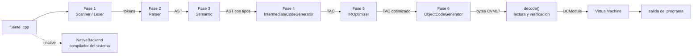

# COMPILADOR-C

Compilador educativo para un subconjunto de **C++17**, escrito en C++17. Recorre las seis
fases clásicas de un compilador y ejecuta el resultado en una máquina virtual propia
(**CVM17**):

1. análisis léxico (tokens)
2. análisis sintáctico (árbol sintáctico, AST)
3. análisis semántico (tipos y tabla de símbolos)
4. código intermedio de tres direcciones (TAC)
5. optimización del código intermedio
6. código objeto binario CVM17, que ejecuta la máquina virtual

Además, un **backend nativo** opcional delega en el compilador C++ del sistema para producir
un objeto ELF/COFF real.

Este documento explica qué hace cada parte del código. Para compilar y usar el programa
paso a paso, consulta también [INSTRUCCIONES.txt](INSTRUCCIONES.txt).

---

## Índice

- [Inicio rápido](#inicio-rápido)
- [Lenguaje aceptado](#lenguaje-aceptado)
- [Arquitectura general](#arquitectura-general)
- [Estructura de archivos](#estructura-de-archivos)
- [Fase 1: análisis léxico](#fase-1-análisis-léxico--lexerh-y-scannerh)
- [El AST](#el-ast--asth)
- [Fase 2: análisis sintáctico](#fase-2-análisis-sintáctico--parserh)
- [Fase 3: análisis semántico](#fase-3-análisis-semántico--semantich-y-symboltableh)
- [Fase 4: código intermedio](#fase-4-código-intermedio--intermediatecodeh)
- [Semántica de valores compartida](#semántica-de-valores-compartida--runtimeh)
- [Fase 5: optimización](#fase-5-optimización--iroptimizerh)
- [Fase 6: código objeto CVM17](#fase-6-código-objeto-cvm17--objectcodegeneratorh)
- [Máquina virtual CVM17](#máquina-virtual-cvm17--virtualmachineh)
- [Backend nativo](#backend-nativo--nativebackendh)
- [Programa principal](#programa-principal--maincpp)
- [Ejemplo completo de las fases](#ejemplo-completo-de-las-fases)
- [Mensajes de error](#mensajes-de-error)
- [Limitaciones conocidas](#limitaciones-conocidas)
- [Cómo extender el compilador](#cómo-extender-el-compilador)

---

## Inicio rápido

```powershell
cmake -S . -B build
cmake --build build --config Release
```

```powershell
./build/CppCompiler --explained codigos/funciones_y_cadenas.cpp
```

| Opción | Efecto |
|---|---|
| `--simple` | Muestra solo la salida del programa. |
| `--explained` | Muestra las seis fases y la ejecución, y guarda los archivos generados en `salida/`. |
| `--todos` | Procesa todos los `.cpp` de la carpeta `codigos`. |
| `--listar` | Lista los archivos de `codigos`. |
| `--native` | Genera un objeto nativo con el compilador del sistema. |
| `-o ruta` | Prefijo de los archivos generados (o ruta del objeto con `--native`). |

Sin `--simple` ni `--explained`, el programa pregunta el modo si la entrada es una terminal y
usa el modo simple en caso contrario (scripts, pruebas).

**Código de salida:** si el programa compila y se ejecuta, el proceso termina con el valor que
devuelve `main`, igual que un ejecutable C++. Un error de compilación o de ejecución devuelve
`1`, y un error de uso o un archivo inexistente devuelve `2`.

---

## Lenguaje aceptado

| Elemento | Soportado |
|---|---|
| Tipos | `int` (32 bits), `double`, `bool`, `std::string` (o `string`), `void` como retorno, `auto` con inicializador |
| Variables | Declaraciones locales, varias por línea (`int a = 1, b;`), `const`, ocultamiento en bloques internos |
| Funciones | Funciones globales, sobrecarga, recursión, llamadas antes de la definición; exactamente un `int main()` |
| Sentencias | `if`/`else`, `while`, `do-while`, `for`, `switch` (con `case`, `default` y caída entre casos), `break`, `continue`, `return`, bloques `{}` y sentencia vacía `;` |
| Operadores | `+ - * / %`, `< > <= >= == !=`, `&& \|\| !`, `& \| ^ ~ << >>`, `=` y compuestos (`+=`, `<<=`, ...), `++`/`--` prefijo y sufijo, ternario `?:`, conversión `(int)` / `(double)` |
| Operadores alternativos | `and`, `or`, `not`, `bitand`, `bitor`, `xor`, `compl`, `not_eq`, `and_eq`, `or_eq`, `xor_eq` |
| Literales | Enteros decimales, hexadecimales (`0x1F`), octales (`017`), binarios (`0b101`), separadores (`1'000`), sufijos `u`/`l`/`f`; decimales (`2.5`, `1e-3`); cadenas y caracteres con escapes `\n \t \r \0` |
| Salida | `std::cout << ... << std::endl;` (también `cout` y `endl` sin `std::`) |
| Preprocesador | Las líneas con `#` (`#include`, etc.) se ignoran; se acepta `using namespace std;` |

**No soportado:** arreglos, punteros y referencias, clases y métodos, variables globales,
`char`/`float`/`long` y tipos compuestos, `std::cin`, excepciones (`try`/`throw`) y
`for` por rango. El parser reconoce varias de estas construcciones para poder dar un error
claro en la fase semántica, en lugar de un error de sintaxis confuso.

---

## Arquitectura general



Ideas que atraviesan todo el diseño:

- **Errores tempranos.** Cada fase lanza `std::runtime_error` con un prefijo que indica dónde
  falló (`Error lexico`, `Error sintactico`, `Error semantico`, `Error de ejecucion`...).
  `main.cpp` lo captura y lo muestra como `[ERROR] ...`.
- **El programa siempre pasa por todas las fases.** No hay un intérprete del AST: lo que se
  ejecuta es el binario CVM17, leído de vuelta desde sus propios bytes y verificado antes de
  ejecutarse.
- **Una sola definición de la semántica de valores.** `Runtime.h` define cómo se comporta cada
  operación, y lo usan tanto el optimizador (para plegar constantes) como la VM (para
  ejecutar). Por eso el código optimizado y el no optimizado nunca divergen.
- **Una sola unidad de compilación.** Solo `main.cpp` se compila; los demás archivos son
  encabezados (`.h`) incluidos en orden.

---

## Estructura de archivos

| Archivo | Responsabilidad |
|---|---|
| [main.cpp](main.cpp) | Línea de comandos, selección de archivos, encadenamiento de las fases y presentación del modo explicado. |
| [Lexer.h](Lexer.h) | Reconoce un token a la vez (palabras clave, identificadores, números, cadenas, operadores). |
| [Scanner.h](Scanner.h) | Recorre la fuente completa con el `Lexer` y convierte los tokens inválidos en errores léxicos. |
| [AST.h](AST.h) | Tipo `Value` (valores en tiempo de compilación y ejecución) y nodos del árbol sintáctico. |
| [Parser.h](Parser.h) | Análisis sintáctico descendente recursivo; construye el AST. |
| [SymbolTable.h](SymbolTable.h) | Pila de ámbitos con nombre, tipo y constancia de cada variable. |
| [Semantic.h](Semantic.h) | Comprobación de tipos, declaraciones, sobrecarga, retornos, bucles y `switch`. |
| [IntermediateCode.h](IntermediateCode.h) | Traduce el AST a código de tres direcciones (TAC) e imprime su listado. |
| [Runtime.h](Runtime.h) | Semántica de operadores, conversiones y errores de ejecución compartida. |
| [IROptimizer.h](IROptimizer.h) | Optimizaciones sobre el TAC. |
| [ObjectCodeGenerator.h](ObjectCodeGenerator.h) | Codifica el TAC como módulo binario CVM17, lo decodifica, lo valida y lo desensambla. |
| [VirtualMachine.h](VirtualMachine.h) | Ejecuta el módulo CVM17. |
| [NativeBackend.h](NativeBackend.h) | Invoca al compilador C++ del sistema para generar un objeto nativo. |
| [NativeCompilerConfig.h.in](NativeCompilerConfig.h.in) | Plantilla que CMake rellena con la ruta del compilador anfitrión. |
| [CMakeLists.txt](CMakeLists.txt) | Construcción, advertencias estrictas y sanitizers opcionales. |
| [codigos/](codigos) | Programas de ejemplo; el compilador busca aquí los archivos por defecto. |

El orden de inclusión refleja las dependencias:
`Lexer → Scanner`, `AST → Parser → Semantic`, `AST → Runtime → IntermediateCode → IROptimizer`,
`IntermediateCode → ObjectCodeGenerator → VirtualMachine`.

---

## Fase 1: análisis léxico — `Lexer.h` y `Scanner.h`

### Token

```cpp
enum TokenType { KEYWORD, IDENTIFIER, NUMBER, DOUBLE_LIT, STRING_LIT,
                 OPERATOR, SYMBOL, END_OF_FILE, UNKNOWN };
struct Token { TokenType type; string value; int line; };
```

### Qué hace el `Lexer`

`Lexer::getNextToken()` salta espacios y comentarios y devuelve el siguiente token:

| Entrada | Resultado |
|---|---|
| Espacios, `// ...`, `/* ... */` | Se descartan. Un comentario de bloque sin cerrar produce un token `UNKNOWN`. |
| `#...` hasta fin de línea | Se descarta (directivas del preprocesador como `#include`). |
| Letra, `_` o `$` seguidos de alfanuméricos | `KEYWORD` si está en la lista de palabras reservadas de C++17; `OPERATOR` si es un operador alternativo (`and`, `not_eq`...); si no, `IDENTIFIER`. |
| Dígito, o `.` seguido de dígito | `NUMBER` o `DOUBLE_LIT`. Acepta hexadecimal (incluido el flotante con `p`), binario, separadores `'` y sufijos `u l f`. Un exponente sin dígitos (`1e`) es un error léxico. |
| `"..."` o `'.'` | `STRING_LIT` con los escapes ya resueltos. Los literales de carácter también son `STRING_LIT` de longitud 1. |
| Operadores | `OPERATOR` con *maximal munch*: se prueban primero los más largos (`<<=` antes que `<<` antes que `<`). |
| `( ) { } [ ] ; , . ? :` | `SYMBOL`. |
| Cualquier otra cosa | `UNKNOWN`. |

Cada token guarda su **número de línea**, que se propaga a todos los mensajes de error y a
los listados de las fases siguientes.

### Qué hace el `Scanner`

`Scanner::scanAll()` llama al `Lexer` hasta `END_OF_FILE` y devuelve el vector de tokens. Si
encuentra un `UNKNOWN`, lanza `Error lexico (linea N): ...` y describe el carácter (o su byte
en hexadecimal si no es imprimible).

---

## El AST — `AST.h`

### `Value`

Representa un valor tanto en tiempo de compilación (literales, constantes plegadas) como en
tiempo de ejecución (contenido de los registros de la VM):

```cpp
struct Value {
    enum T { V_VOID, INT, DOUBLE, BOOL, STR, ARR, NUL, EXC } t;
    int32_t i; double d; bool b; string s; ...
};
```

`ARR` y `EXC` existen para futuras ampliaciones (arreglos y excepciones); el compilador actual
no los produce. `Value::Int()` trunca a 32 bits, como un `int` de C++.

### `Node`

Todos los nodos tienen la misma estructura y su **clase** (`NK`) determina cómo se usan los
campos:

```cpp
struct Node {
    NK k;                     // clase de nodo
    string name, type, op;    // nombre, tipo, operador
    Value val;                // literal
    vector<NP> a, b;          // hijos
    bool flag;                // significado segun la clase
    int line;
};
```

| Nodo | Campos usados |
|---|---|
| `Program` | `a` = unidades (`Class`) |
| `Class` | `name`; `a` = miembros. Las funciones globales se agrupan en una unidad llamada `<global>`. |
| `Method` | `type` = retorno, `name`, `op` = unidad, `b` = parámetros (`VarDecl`), `a[0]` = cuerpo (`Block`) |
| `VarDecl` | `type`, `name`, `flag` = `const`, `a[0]` = inicializador opcional |
| `Block` | `a` = sentencias; `flag = true` significa "sin ámbito propio" (ver abajo) |
| `ExprStmt` | `a[0]` = expresión |
| `StreamOutput` | `a` = valores a imprimir, `flag` = termina con `std::endl` |
| `If` | `a[0]` = condición, `a[1]` = entonces, `a[2]` = si-no (opcional) |
| `While` | `a[0]` = condición, `a[1]` = cuerpo |
| `DoWhile` | `a[0]` = cuerpo, `a[1]` = condición |
| `For` | `a = {inicialización, condición, actualización, cuerpo}`; las tres primeras pueden ser nulas |
| `Switch` | `a[0]` = selector, `b` = secciones (`Case`) |
| `Case` | `flag` = es `default`; si no, `a[0]` = valor; el resto de `a` son sentencias |
| `Return` | `a[0]` = valor opcional |
| `Break`, `Continue` | sin campos |
| `Lit` | `val` |
| `Var` | `name` |
| `Binary` | `op`, `a[0]`, `a[1]` |
| `Unary` | `op`, `a[0]` |
| `Assign` | `op` (`=`, `+=`...), `a[0]` = destino, `a[1]` = valor |
| `IncDec` | `op` (`++`/`--`), `flag` = prefijo, `a[0]` = variable |
| `Call` | `name`, `a` = argumentos |
| `Ternary` | `a[0]` = condición, `a[1]` = si-verdadero, `a[2]` = si-falso |
| `Cast` | `type`, `a[0]` |

`Field`, `ForEach`, `Try`, `Catch`, `Throw`, `MethodCall`, `Member`, `Index`, `NewArray`,
`ArrayInit` y `NewObj` se construyen en el parser solo para que la fase semántica los rechace
con un mensaje claro.

**Bloques sin ámbito propio (`flag = true`).** Se usan para:
- agrupar `int a = 1, b = 2;` en un nodo sin abrir un ámbito nuevo (las variables pertenecen al bloque que las contiene);
- representar la sentencia vacía `;`;
- el cuerpo de una función: la fase semántica lo marca así porque comparte ámbito con los parámetros.

---

## Fase 2: análisis sintáctico — `Parser.h`

Es un parser **descendente recursivo** con *precedence climbing* para las expresiones
binarias. Recibe el vector de tokens y produce el AST.

### Programa

`parseProgram()` acepta `using namespace std;` al principio. Si lo siguiente es un tipo, lee
una secuencia de funciones globales y las agrupa en la unidad `<global>`. En caso contrario
intenta leer clases (`class X { ... };`), que la fase semántica rechaza.

### Sentencias

`parseStatement()` decide qué sentencia sigue mirando el token actual:

- `{` → bloque; `;` → sentencia vacía
- `cout <<` o `std::cout <<` → `StreamOutput`
- palabras clave → `switch`, `if`, `while`, `do`, `for`, `return`, `break`, `continue` (y `throw`/`try`, que se rechazan después)
- un tipo seguido de un identificador → declaración local (`parseLocalDecl`)
- cualquier otra cosa → sentencia de expresión. Solo se aceptan expresiones con efecto
  (asignación, `++`/`--`, llamada); `x + 1;` es un error de sintaxis.

### Expresiones y precedencia

De menor a mayor precedencia:

| Nivel | Operadores | Asociatividad | Función |
|---|---|---|---|
| — | `=  +=  -=  *=  /=  %=  &=  \|=  ^=  <<=  >>=` | derecha | `parseAssignment` |
| — | `?:` | derecha | `parseTernary` |
| 1 | `\|\|` `or` | izquierda | `parseBinary` |
| 2 | `&&` `and` | izquierda | |
| 3 | `\|` `bitor` | izquierda | |
| 4 | `^` `xor` | izquierda | |
| 5 | `&` `bitand` | izquierda | |
| 6 | `==` `!=` `not_eq` | izquierda | |
| 7 | `<` `>` `<=` `>=` | izquierda | |
| 8 | `<<` `>>` | izquierda | |
| 9 | `+` `-` | izquierda | |
| 10 | `*` `/` `%` | izquierda | |
| — | `!` `-` `+` `~` prefijos, `++`/`--` prefijos, `(int)x` | derecha | `parseUnary` |
| — | `x++`, `x--` (y `.` y `[]`, rechazados después) | izquierda | `parsePostfix` |
| — | literales, variables, llamadas `f(...)`, `( expr )` | — | `parsePrimary` |

Los operadores alternativos se normalizan a su forma simbólica (`and` → `&&`) con
`canonicalOperator`, así que las fases siguientes solo ven una forma.

### Detalles de C++ que respeta

- **Operandos de `cout`.** Cada operando se analiza con `parseBinary(9)`: solo admite
  operadores con más precedencia que `<<`. Así, `cout << a + b` funciona, y `cout << a < b`
  da un error que pide paréntesis, porque en C++ ese `<` se aplicaría al flujo.
  `std::endl` debe ser el último elemento.
- **Literales enteros.** Se exige que todo el literal sea válido (`08` es un error, como en
  C++) y que quepa en un `int`. `-2147483648` se trata como un caso especial.
- **Tipos no soportados.** `char`, `float`, `long`, etc. se aceptan sintácticamente para que
  la fase semántica dé un mensaje claro; los tipos compuestos (`unsigned int`) se rechazan aquí.

---

## Fase 3: análisis semántico — `Semantic.h` y `SymbolTable.h`

### `SymbolTable`

Pila de ámbitos (`vector<unordered_map<string, Symbol>>`) con el tipo y la constancia de cada
variable:

- `push()` / `pop()` abren y cierran un ámbito;
- `insert()` falla si el nombre ya existe **en el mismo ámbito** (ocultar uno exterior sí está permitido);
- `lookup()` e `isConst()` buscan del ámbito más interno al más externo.

### Recorrido

`Semantic::check()` hace dos pasadas sobre el programa:

1. **Firmas.** Registra todas las funciones (nombre, retorno y tipos de parámetro), lo que
   permite llamar a una función definida más abajo. Rechaza firmas duplicadas, tipos
   desconocidos y miembros que no sean funciones.
2. **Cuerpos.** Para cada función abre un ámbito con los parámetros y comprueba su cuerpo con
   `checkStmt`. Exige exactamente un `int main()` sin parámetros, y que toda función que no
   sea `void` (salvo `main`) devuelva un valor en todos los caminos.

### Tipos de las expresiones (`infer`)

Los tipos se representan como cadenas: `int`, `double`, `bool`, `std::string`, `void` y el
tipo interno `string_literal` para las cadenas literales (en C++ un literal no es un
`std::string`).

| Expresión | Regla |
|---|---|
| `a + b`, `a - b`, `a * b`, `a / b` | Operandos numéricos (`int`, `double`, `bool`); el resultado es `double` si alguno lo es, si no `int`. |
| `a % b` y `%=` | Solo enteros (`int`/`bool`). |
| `+` con cadenas | `std::string + std::string` o con un literal en cualquiera de los lados → `std::string`. Dos literales no se pueden sumar (igual que en C++). |
| `< > <= >=` | Numéricos → `bool`. |
| `== !=` | Numéricos entre sí, o cadenas entre sí → `bool`. |
| `&& \|\| !` | Numéricos → `bool`. |
| `& \| ^ << >> ~` | `int`/`bool` → `int`. |
| `-x`, `+x` | Numérico; `bool` se promueve a `int`. |
| `x = v` | `v` debe ser compatible con el tipo de `x`; `x` no puede ser `const`. |
| `x++`, `--x` | Solo `int` y `double`. |
| `c ? a : b` | `c` escalar; `a` y `b` deben tener **el mismo tipo**. |
| `(int)x`, `(double)x` | `x` numérico. |
| `f(args)` | Resolución de sobrecarga (ver abajo). |

**Compatibilidad** (`compat`): un tipo es compatible consigo mismo, los numéricos entre sí
(con conversión implícita, como en C++) y `std::string` acepta un `string_literal`.

**Sobrecarga** (`resolveCall`): de las funciones con el nombre y número de argumentos
correctos se descartan las que no son compatibles. Cada argumento suma 4 puntos si su tipo
coincide exactamente y 1 si requiere conversión; gana la de mayor puntuación. Un empate es un
error de llamada ambigua. `main` no se puede llamar.

### Comprobaciones de sentencias (`checkStmt`)

- **Declaraciones:** tipo soportado, `auto` deducido del inicializador, `const` obligatoriamente
  inicializado, sin redeclarar en el mismo ámbito. El inicializador se comprueba antes de
  declarar la variable.
- **Condiciones** de `if`, `while`, `do` y `for`: deben ser escalares.
- **Cuerpos** de `if`/`while`/`for`: no pueden ser una declaración suelta (`if (c) int x;`).
- **`break` y `continue`:** contadores `breakDepth` y `loopDepth` garantizan que `break` esté
  dentro de un bucle o `switch` y `continue` dentro de un bucle.
- **`switch`:** selector `int` o `bool`; cada `case` debe ser una **expresión constante
  entera** (se evalúa con `integralConstant`, que pliega aritmética, bits y comparaciones);
  sin valores repetidos ni dos `default`. Todo el `switch` comparte un ámbito.
- **`return`:** sin valor en funciones `void` y con un valor compatible en las demás.

### Análisis de retorno (`alwaysReturns`)

Decide si una sentencia garantiza llegar a un `return`:

- un `return` sí;
- un bloque, si alguna de sus sentencias lo garantiza **antes** de que un `break` pueda salir;
- un `if` con `else`, si ambas ramas lo garantizan;
- un `switch` con `default`, si desde cada etiqueta (contando la caída a las siguientes) se
  llega a un `return` antes de un `break`;
- los bucles, nunca (es una regla conservadora).

`mayBreak` detecta un `break` que saldría del `switch` o bucle actual, ignorando los que
pertenecen a bucles o `switch` anidados.

---

## Fase 4: código intermedio — `IntermediateCode.h`

`IntermediateCodeGenerator::generate()` traduce cada función del AST a una lista de
instrucciones de **tres direcciones** (`IRFunction::code`).

### Operandos

| Clase | Ejemplo en el listado | Significado |
|---|---|---|
| `Var` | `total`, `x.1` | Variable del programa con nombre único dentro de la función. |
| `Temp` | `%t3` | Temporal creado por el compilador. |
| `Const` | `#i:5`, `#d:2.5`, `#b:true`, `#s:"hola"` | Constante. |
| `None` | `_` | Sin operando. |

**Renombrado de variables.** Cada declaración recibe un nombre único en la función
(`x`, `x.1`, `x.2`...), resuelto con una pila de ámbitos. Así el IR ya no necesita ámbitos:
dos variables `x` en bloques distintos son variables distintas.

### Instrucciones

| Instrucción | Forma | Uso |
|---|---|---|
| `LABEL` | `L:` | Destino de salto. |
| `DECLARE` | `DECLARE int x` | Declara la variable y su tipo. |
| `MOVE` | `x <- a` | Copia (convirtiendo al tipo de `x` si es una variable). |
| `BINARY` | `t <- a op b` | Operación binaria. |
| `UNARY` | `t <- op a` | Operación unaria. |
| `INCDEC` | `t <- ++x` / `t <- x++` | Incremento o decremento de una variable. |
| `CAST` | `t <- (double) a` | Conversión explícita. |
| `CALL` | `t <- f(a, b)` | Llamada a función. |
| `RETURN` | `RETURN a` | Retorno, con o sin valor. |
| `PRINT` / `PRINTLN` | `PRINT a` | Escribe un valor / un salto de línea. |
| `JUMP` | `JUMP L` | Salto incondicional. |
| `JUMP_FALSE` / `JUMP_TRUE` | `JUMP_FALSE c -> L` | Salto condicional. |
| `NOP` | — | Hueco que deja el optimizador; se elimina. |

### Esquemas de traducción

```text
if (c) S1 else S2          while (c) S                for (I; c; U) S
  JUMP_FALSE c -> else       while_start:                I
  S1                         JUMP_FALSE c -> end        for_start:
  JUMP end                   S                          JUMP_FALSE c -> end
else:                        JUMP while_start           S
  S2                       end:                       for_update:
end:                                                    U
                                                        JUMP for_start
                                                      end:
```

- **`do-while`:** cuerpo, etiqueta `do_cond`, `JUMP_TRUE c -> do_start`.
- **`switch`:** compara el selector con cada `case` (`t <- sel == v`, `JUMP_TRUE t -> case`),
  salta a `default` (o al final) si ninguno coincide y luego emite las secciones en orden, con
  lo que la caída entre casos sale gratis. `break` salta al final del `switch`; `continue`
  sigue apuntando al bucle exterior.
- **`&&` y `||`** se compilan con saltos (**cortocircuito**): el lado derecho solo se evalúa si hace falta.
- **`?:`** usa dos ramas que escriben el mismo temporal.
- **`cout << a << b`** imprime cada valor justo después de evaluarlo, respetando el orden de C++17.

### Orden de evaluación

- **Asignación compuesta** (`x += e`): primero se evalúa `e` y después se lee `x`, como exige
  C++17. Por eso `a += a++` con `a = 1` da `3`.
- **Inicializadores:** se evalúan antes de declarar la variable, así que no ven la variable
  que declaran.
- **Instantáneas:** si un operando es una variable y otro operando posterior tiene efectos
  (`x + x++`, `f(x, x = 3)`), se copia la variable a un temporal antes de evaluar el resto.

`formatIR()` produce el listado de texto que se ve en el modo explicado y en `salida/*.ir`.

---

## Semántica de valores compartida — `Runtime.h`

Define, en un único lugar, cómo se comporta cada operación sobre `Value`. La usan el
optimizador y la VM.

| Función | Qué hace |
|---|---|
| `binaryOp` | Operaciones binarias. Con enteros, detecta desbordamiento (`checkedInt`), división y módulo por cero, y desplazamientos fuera de rango; `1 << 31` da `INT_MIN`, como define C++17. Con `double`, sigue IEEE 754. `+` con cadenas concatena. |
| `unaryOp` | `-`, `+`, `!`, `~`; `-INT_MIN` es un error de desbordamiento. |
| `castOp` | `(int)` trunca hacia cero y falla si el `double` no cabe en un `int`; `(double)` convierte. |
| `coerceTo` | Conversión implícita al tipo de una variable o parámetro (`double` → `int`, número → `bool`...). |
| `incDecValue` | Nuevo valor de `++`/`--`, con comprobación de desbordamiento. |
| `truthValue` | Valor de verdad de una condición (debe ser escalar). |

También define los códigos `BinOp`, `UnOp` y `TypeCode` (`T_INT = 1`, `T_DOUBLE`, `T_BOOL`,
`T_STRING`, `T_VOID`), que se guardan tal cual en el binario CVM17.

Los comportamientos indefinidos de C++ (desbordamiento de `int`, dividir por cero, desplazar
32 posiciones...) se convierten aquí en **errores de ejecución controlados**, con el número
de línea.

---

## Fase 5: optimización — `IROptimizer.h`

`IROptimizer::optimize()` aplica a cada función tres grupos de pasadas y los repite (hasta 12
rondas) mientras alguno cambie algo.

1. **Propagación y plegado** (`propagateAndFold`), dentro de cada bloque básico (el
   conocimiento se descarta en cada etiqueta y en cada salto):
   - *propagación de constantes y copias:* sustituye lecturas de una variable o temporal por
     su valor conocido;
   - *plegado de constantes:* evalúa en compilación `BINARY`, `UNARY` y `CAST` con operandos
     constantes, usando `Runtime.h`. **Si la operación fallaría al ejecutarse (por ejemplo,
     dividir por cero), no se pliega**, para que el error ocurra en ejecución con su línea;
   - *simplificaciones algebraicas:* `x + 0`, `x - 0`, `x * 1`, `x / 1` (solo con variables `int`);
   - *saltos con condición constante:* se convierten en `JUMP` o se eliminan.
2. **Flujo de control** (`simplifyControlFlow`):
   - elimina el código inalcanzable que sigue a un `JUMP` o `RETURN` hasta la siguiente
     etiqueta usada. Los `DECLARE` se conservan, porque el tipo de una variable es estático
     (un `case` puede usar una variable declarada en otro `case` que nunca se ejecuta);
   - encadena saltos: `JUMP L` donde `L:` es `JUMP M` pasa a `JUMP M`;
   - quita los saltos a la instrucción siguiente y las etiquetas sin uso.
3. **Código muerto** (`removeDeadCode`):
   - elimina asignaciones a temporales que nunca se leen y asignaciones de constantes a
     variables que nunca se leen;
   - en `CALL` e `INCDEC` cuyo resultado no se usa, elimina solo el destino (el efecto se conserva);
   - elimina los `DECLARE` de variables que ya no aparecen en ninguna instrucción.

`OptStats` cuenta cada transformación; el modo explicado muestra el resumen.

**Ejemplo:**

```cpp
const int base = 4;
int area = base * base + 0;
if (area > 10) std::cout << "grande" << std::endl;
else           std::cout << "chico" << std::endl;
return 0;
```

El TAC original tiene 16 instrucciones; el optimizado, 3:

```text
    PRINT      #s:"grande"
    PRINTLN
    RETURN     #i:0
```

`base` se propaga, `4 * 4 + 0` se pliega a `16`, `16 > 10` a `true`, el salto se resuelve, la
rama `else` queda inalcanzable y las variables sin lecturas desaparecen.

---

## Fase 6: código objeto CVM17 — `ObjectCodeGenerator.h`

### Generación

`ObjectCodeGenerator::generate()` construye primero un `BCModule` en memoria y después lo
serializa:

1. Asigna a cada variable o temporal de una función un **slot** (registro local). Los
   parámetros ocupan los primeros slots, en orden.
2. Guarda las constantes en un **pool** sin duplicados, compartido por todo el módulo.
3. **Primera pasada:** calcula la posición (pc) de cada etiqueta.
4. **Segunda pasada:** codifica cada instrucción; los saltos llevan el pc absoluto de destino
   y las etiquetas desaparecen.
5. Añade `FNEND` al final de cada función.
6. Valida el módulo, lo serializa y lo vuelve a decodificar como comprobación de ida y vuelta.

### Formato binario (versión 2, little-endian)

```text
cabecera    "CVM17OBJ" | u16 version=2 | u16 flags=0
constantes  u32 n  { u8 tag (1 int32, 2 double, 3 bool, 4 string, 5 null) + datos }
funciones   u32 n  { str nombre | u8 retorno | u16 nparams | u8 tipos[nparams] |
                     u32 nslots | u32 pc_entrada | u32 pc_fin | str nombres_de_slot[nslots] }
codigo      u32 n  { u8 opcode | u8 sub | u16 argc | u32 linea | i32 dst | i32 a | i32 b | i32 args[argc] }
```

`str` es una longitud `u32` seguida de los bytes. Cada instrucción ocupa 20 bytes más 4 por argumento.

**Operandos:** un valor `>= 0` es un slot local; un valor negativo es la constante número
`-(valor + 1)` del pool; `INT32_MIN` significa "sin operando".

| Opcode | Nombre | `sub` | Operandos |
|---|---|---|---|
| `01` | `DECLARE` | tipo | `dst` |
| `02` | `MOVE` | — | `dst <- a` |
| `03` | `BINARY` | `BinOp` | `dst <- a op b` |
| `04` | `UNARY` | `UnOp` | `dst <- op a` |
| `05` | `INCDEC` | bit 0 = `--`, bit 1 = prefijo | `dst <- a` (actualiza `a`) |
| `06` | `CAST` | tipo | `dst <- (tipo) a` |
| `07` | `CALL` | — | `dst <- funcion(args)`; `a` es la constante con el nombre |
| `08` | `RET` | — | `a` opcional |
| `09` | `PRINT` | — | `a` |
| `0A` | `PRINTLN` | — | — |
| `0B` | `JMP` | — | `dst` = pc destino |
| `0C` | `JMPF` | — | `a` = condición, `dst` = pc destino |
| `0D` | `JMPT` | — | `a` = condición, `dst` = pc destino |
| `0E` | `FNEND` | — | marca el final de una función |

### Verificación

`decode()` comprueba la firma, la versión, que no haya datos truncados ni bytes sobrantes, y
después `validate()` comprueba que cada función termine en `FNEND`, que los operandos y los
saltos estén dentro de su función, que los `CALL` nombren una función mediante una constante
de texto y que haya exactamente un `main`.

`disassemble()` y `hexDump()` producen los listados del modo explicado y de
`salida/*.obj.txt`.

---

## Máquina virtual CVM17 — `VirtualMachine.h`

`VirtualMachine::run()` ejecuta `main` y devuelve su código de salida.

- **Pila de marcos propia.** Cada llamada crea un `Frame` con su pc, sus slots, la marca de
  inicializado de cada slot y su tipo. La VM no usa recursión de C++, así que una recursión
  infinita en el programa da un error controlado en lugar de desbordar la pila.
- **Tipos de los slots.** Al construir la VM, se calcula el tipo de cada slot a partir de los
  parámetros y de las instrucciones `DECLARE` de la función. `MOVE` convierte siempre al tipo
  declarado, aunque un salto haya pasado por encima del `DECLARE`.
- **Variables sin inicializar.** `DECLARE` marca el slot como no inicializado; leerlo antes de
  escribirlo es un error de ejecución.
- **Llamadas.** La sobrecarga se vuelve a resolver con los tipos reales de los argumentos (con
  las mismas puntuaciones que la fase semántica) y los argumentos se convierten al tipo del
  parámetro.
- **Retornos.** El valor se convierte al tipo de retorno. Si una función no `void` llega a
  `FNEND` sin `return`, se produce un error. El `return` de `main` es el código de salida
  (`0` si no hay `return`).
- **Salida.** `bool` se imprime como `1`/`0` y `double` con el mismo formato por defecto que
  `std::cout` (6 cifras significativas: `3`, `0.333333`, `1e+20`).
- **Límites:** 100 millones de instrucciones y 20 000 llamadas anidadas; al superarlos se
  produce un error de ejecución controlado.

---

## Backend nativo — `NativeBackend.h`

Con `--native`, el programa no usa las fases propias: llama al compilador C++ del sistema con
`-std=c++17 -Wall -Wextra -pedantic -c` (o `/std:c++17 /W4 /c` con MSVC) y genera un objeto
ELF/COFF real.

- La ruta del compilador es la misma que CMake usó para construir el proyecto: CMake rellena
  `NativeCompilerConfig.h.in` y genera `NativeCompilerConfig.h` en la carpeta de compilación.
- `shellQuote` protege las rutas con espacios, con las reglas de Windows o de POSIX.
- Si el compilador falla, se borra cualquier objeto parcial para no dejarlo como válido.

---

## Programa principal — `main.cpp`

1. **Argumentos.** Interpreta las opciones de la tabla de [Inicio rápido](#inicio-rápido).
2. **Búsqueda de archivos.** Busca la carpeta `codigos` en el directorio actual, junto al
   ejecutable y en la carpeta superior. Un nombre sin ruta se busca primero en el directorio
   actual y después en `codigos` (con o sin `.cpp`). Sin archivo, usa el único de `codigos` o
   pregunta cuál (solo en una terminal).
3. **Detección de otros lenguajes.** Tras quitar comentarios y literales, busca patrones de
   Java (`System.out.`, `public class`, `String`, `boolean`...) y rechaza la entrada con un
   mensaje que explica el subconjunto aceptado.
4. **Pipeline** (`compileFile`). Ejecuta las fases en orden. En modo explicado muestra la
   fuente, la tabla de tokens con un resumen por categoría, el árbol AST, la tabla de
   símbolos, el TAC original y optimizado con estadísticas, el desensamblado y los primeros
   bytes del binario, y la salida del programa con el número de instrucciones ejecutadas.
5. **Archivos generados.** En modo explicado (o con `-o prefijo`) escribe en `salida/`:

   | Archivo | Contenido |
   |---|---|
   | `nombre.ir` | TAC original |
   | `nombre.opt.ir` | TAC optimizado |
   | `nombre.cobj` | Módulo binario CVM17 |
   | `nombre.obj.txt` | Desensamblado legible |

6. **Código de salida.** Devuelve el de `main` del programa o el código de error. Con `--todos`,
   el primero distinto de cero.

### Construcción (`CMakeLists.txt`)

- Una única unidad de compilación (`main.cpp`) con C++17 obligatorio.
- Advertencias estrictas: `/W4` en MSVC; `-Wall -Wextra -Wpedantic` en los demás.
- Opción `STRICT_SANITIZE` (activada por defecto, salvo en Windows): compila con
  AddressSanitizer y UndefinedBehaviorSanitizer y aborta ante cualquier error de memoria o
  comportamiento indefinido del propio compilador. Se desactiva con `-DSTRICT_SANITIZE=OFF`.

---

## Ejemplo completo de las fases

Programa:

```cpp
#include <iostream>

int cuadrado(int n) {
    return n * n;
}

int main() {
    int total = 0;
    for (int i = 1; i <= 3; i++) {
        total += cuadrado(i);
    }
    std::cout << "total = " << total << std::endl;
    return 0;
}
```

**Fase 1 — tokens** (extracto):

```text
  #    LINEA  CATEGORIA                LEXEMA C++
  1    3      PALABRA RESERVADA C++    'int'
  2    3      IDENTIFICADOR            'cuadrado'
  3    3      SIMBOLO                  '('
  ...
  10   4      OPERADOR                 '*'
```

**Fase 2 — AST** (extracto):

```text
+- Program   [linea 1]
   +- Class  nombre=<global>   [linea 3]
      +- Method  nombre=cuadrado  tipo=int  clase=<global>   [linea 3]
         +- parametro: VarDecl  nombre=n  tipo=int   [linea 3]
         +- Block   [linea 3]
            +- Return   [linea 4]
               +- Binary  operador=*   [linea 4]
                  +- izquierda: Var  nombre=n   [linea 4]
                  +- derecha: Var  nombre=n   [linea 4]
```

**Fase 3 — tabla de símbolos:**

```text
  FUNCION             VARIABLE          TIPO
  cuadrado            n                 int
  main                total             int
  main                i                 int
```

**Fase 4 — TAC de `main`:**

```text
    DECLARE    int total
    MOVE       total <- #i:0
    DECLARE    int i
    MOVE       i <- #i:1
for_start_1:
    BINARY     %t1 <- i <= #i:3
    JUMP_FALSE %t1 -> for_end_3
    CALL       %t2 <- cuadrado(i)
    BINARY     %t3 <- total + %t2
    MOVE       total <- %t3
for_update_2:
    INCDEC     %t4 <- i++
    JUMP       for_start_1
for_end_3:
    PRINT      #s:"total = "
    PRINT      total
    PRINTLN
    RETURN     #i:0
```

**Fase 5 — optimización:** se elimina la etiqueta `for_update_2`, que ningún salto usa, y el
destino `%t4` de `i++`, cuyo valor no se lee (queda `INCDEC i++`).

**Fase 6 — objeto CVM17** (extracto del desensamblado):

```text
[constantes]
  k0 = #i:0
  k1 = #i:1
  k2 = #i:3
  k3 = #s:"cuadrado"
  k4 = #s:"total = "

[funciones]
  int cuadrado(int)  entrada=0000 fin=0002 slots=2
  int main()  entrada=0003 fin=0018 slots=5

[codigo]
0007  03  BINARY  r2(%t1) <- r1(i) <= k2(#i:3)
0008  0C  JMPF    r2(%t1) -> 0014
0009  07  CALL    r3(%t2) <- cuadrado(r1(i))
0010  03  BINARY  r4(%t3) <- r0(total) + r3(%t2)
0011  02  MOVE    r0(total) <- r4(%t3)
0012  05  INCDEC  r1(i)++
0013  0B  JMP     0007
```

**Ejecución:** `total = 14`, código de salida `0`.

---

## Mensajes de error

| Prefijo | Fase | Ejemplo |
|---|---|---|
| `Error lexico (linea N)` | 1 | `Caracter no reconocido '@'`, `literal sin cerrar`, `el exponente no tiene digitos ('1e')` |
| `Error sintactico (linea N)` | 2 | `Token inesperado '}', se esperaba ';'`, `literal entero mal formado: 08`, `el operador '<' se aplicaria a std::cout` |
| `Error semantico (linea N)` | 3 | `La variable 'x' no ha sido declarada`, `Tipos incompatibles`, `Llamada ambigua`, `'continue' fuera de un bucle`, `La funcion no garantiza devolver un valor` |
| `Generacion IR` | 4 | Solo aparece si una construcción pasó la fase semántica sin estar soportada (indica un error interno). |
| `Objeto CVM17` | 6 | Módulo inválido (error interno o archivo corrupto). |
| `Error de ejecucion (linea N)` | VM | `division entera entre cero`, `desbordamiento de int`, `la variable 'x' puede no haber sido inicializada`, `limite de recursion excedido` |

---

## Limitaciones conocidas

Programas válidos en C++ que este compilador rechaza:

- Ternario con ramas de tipos distintos (`c ? 1 : 2.5`); C++ las promovería a `double`.
- `f(true)` con sobrecargas `f(int)` y `f(double)` se considera ambiguo; C++ elige `f(int)`
  porque `bool → int` es una promoción.
- `int f() { while (true) return 1; }`: el análisis de retorno no reconoce los bucles infinitos.
- `return g();` en una función `void` cuando `g` también es `void`.
- Escapes `\x41` y octales `\101`: no se interpretan.
- `#` en mitad de una línea descarta el resto de la línea, no solo las directivas.

Diferencias deliberadas:

- Todo comportamiento indefinido de C++ se convierte en un error controlado (por ejemplo,
  `3 << 31` o una función que llega al final sin `return`).
- Las funciones no `void` deben devolver un valor en todos los caminos (en C++ solo es una advertencia).
- Saltar con un `case` por encima de una declaración **con** inicializador no se rechaza en la
  fase semántica (C++ sí lo rechaza); leer esa variable sin asignarla da un error de ejecución.

---

## Cómo extender el compilador

Ejemplo: añadir un operador binario nuevo.

1. **`Lexer.h`**: si es un símbolo nuevo, añadirlo a la tabla `ops` respetando el orden de mayor a menor longitud.
2. **`Parser.h`**: darle un nivel en `prec()`; si es una palabra alternativa, normalizarla en `canonicalOperator`.
3. **`Semantic.h`**: añadir su regla de tipos en `inferCore` (y en `integralConstant` si debe poder usarse en un `case`).
4. **`Runtime.h`**: añadirlo a `BinOp`, a `binOpText` (en el mismo orden) y a `binaryOp`.
5. El TAC, el optimizador, el binario y la VM lo usan automáticamente a través de `binOpFromText`
   y `binaryOp`. Si cambia el significado de un código existente, sube la versión del formato
   en `ObjectCodeGenerator.h`.

Para un tipo nuevo hay que tocar, además, `checkType` y `compat` en `Semantic.h`, `TypeCode`,
`typeFromName` y `coerceTo` en `Runtime.h`, y el formato de constantes de
`ObjectCodeGenerator.h` si el tipo puede aparecer como literal.
